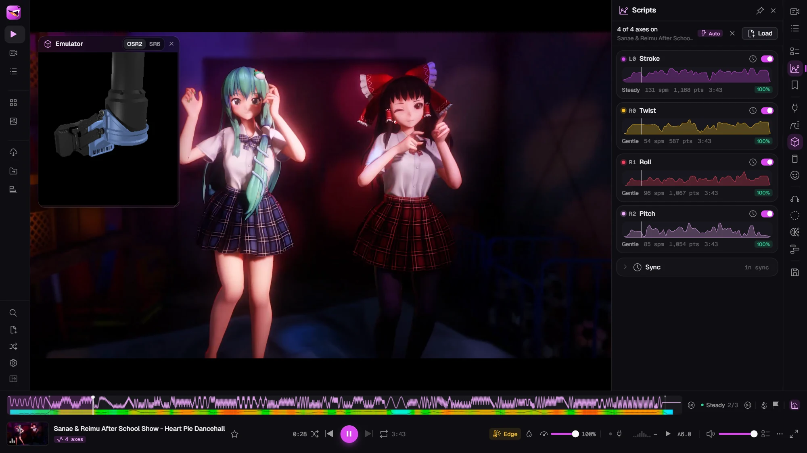

<p align="center">
  
</p>

<h1 align="center">playhound</h1>

<p align="center">
  <a href="https://github.com/whatmekota/playhound/releases/latest"></a>
  <a href="https://github.com/whatmekota/playhound/releases"></a>
  <a href="LICENSE"></a>
  <a href="https://github.com/whatmekota/playhound/actions/workflows/test.yml"></a>
  <a href="https://whatmekota.github.io/playhound/"></a>
  <a href="https://discuss.eroscripts.com/t/playhound-audiovisual-session-engine-yet-another-funscript-player/345390"></a>
  <a href="#safety"></a>
</p>

A funscript video player and audiovisual session engine for your own library and
your own hardware: OSR2/SR6 strokers over TCode, Intiface/Buttplug toys, and an
on-screen emulator when nothing is plugged in.

It plays your videos with their scripts, finds the good parts, follows the music
when there's no script, and can run a whole session by itself, with binaural
audio, a hypnotic overlay, a heart-rate monitor and a phone in your other hand
as the remote.

I built this for myself initially. I wanted my own player, I had a few
half-finished pet projects lying around (binaural beats with visuals, and a
little CYD screen with eyes), and at some point I mixed them all into one big
app with the help of an AI. It has grown big enough that it might be useful to
someone else, so here it is.

<p align="center">
  <a href="https://whatmekota.github.io/playhound/"></a>
</p>

> [!WARNING]
> **18+ only.** playhound is made for adult content and drives physical
> devices. Read [Safety](#safety) before connecting hardware.

## Try it now, no install

**[Open playhound in your browser](https://whatmekota.github.io/playhound/)** (Chrome, Edge or another
Chromium browser), then:

1. Click **Open a folder** and pick a folder of videos with their funscripts,
   or drop one video and its script onto the page.
2. Open the **Emulator** (the cube in the right rail) to watch what a stroker
   would do, and the **Motion** panel to see the rate and the sources.
3. Press **E** to edge, **G** to jump to the next peak, **?** for every key and
   **Ctrl+K** for everything else.

Your videos stay on your computer: the page reads them in place and nothing is
uploaded. Like it? [Get the Windows app](https://github.com/whatmekota/playhound/releases) for the full thing
([what's different](#three-ways-to-run-it)).

---

## Highlights

- **Plays scripts properly.** Multi-axis funscripts (`.pitch`, `.roll`, `.twist`,
  `.surge`, `.sway`, …) are matched to videos automatically. You get latency
  calibration, a per-video script offset, A–B loops and speed control, and a
  timeline that shows the script's intensity, chapters, bookmarks and your past
  edges and finishes.
- **No script? Use the music.** It finds the beat in the video's soundtrack and
  strokes in time with it, or writes a real `.funscript` from the whole track
  that you can save and edit.
- **Stays in control.** **E** edges: everything backs off for a while and eases
  back in. An intensity knob scales every source. **G** jumps to the next
  peak and **Shift+G** to the most intense part. **Esc** is panic.
- **Programmes.** Plan a session in phases (warm-up, build, edges, peak,
  cool-down). playhound then picks chapters across your library to match the
  plan and plays them as a highlight reel.
- **Session engine.** It can also run without a video: a binaural tone
  generator with noise, a breathing hypno overlay, a free-form media wall
  (local files and YouTube) and a beat-synced slideshow, all moving through
  phases together.
- **Body in the loop.** A Bluetooth heart-rate monitor can call an edge for you
  when your rate climbs fast. Vibrators get a strength worked out from the
  script, the music or the session.
- **Streams straight from the post.** Pixeldrain, Gofile, MEGA, Iwara,
  Rule34Video and PMVHaven links play without downloading anything first, with
  seeking and a quality choice; Pornhub, XVideos, Hanime1, rule34.xyz and many
  more go through yt-dlp, which playhound fetches for you if you want it. Or
  download the video with its scripts, named so the library pairs them.
- **Remotes.** Use a phone over Wi-Fi (big buttons, panic in the thumb zone), a
  gamepad, or an [ESP32 "Cheap Yellow Display"](firmware/cyd-face) face that
  watches the session and reacts. The face also comes as Kerfus, the cat robot,
  and can fill a second monitor instead of a board.
- **Desktop app.** A Windows build with a frameless window. It keeps driving the
  device while minimised, remembers your library folder, and can show Discord
  Rich Presence (off by default).

## Getting started

### Three ways to run it

|                                                             | [Browser](https://whatmekota.github.io/playhound/) | [Windows app](https://github.com/whatmekota/playhound/releases) | From source |
| ----------------------------------------------------------- | :------------------------------------------------: | :-------------------------------------------------------------: | :---------: |
| Your library, the player, programmes, the session engine    |                         ✓                          |                                ✓                                |      ✓      |
| TCode devices (Web Serial), heart-rate monitors (Bluetooth) |                         ✓                          |                                ✓                                |      ✓      |
| Intiface / Buttplug toys                                    |                        ✓\*                         |                                ✓                                |      ✓      |
| EroScripts browser, phone remote, CYD face                  |                                                    |                                ✓                                |      ✓      |
| Streaming from file hosts and yt-dlp sites                  |                                                    |                                ✓                                |      ✓      |
| Kerfus face on a second monitor                             |                         ✓                          |                                ✓                                |      ✓      |
| Remembers your library folder without a click               |                                                    |                                ✓                                |             |
| Keeps driving the device while minimised                    |                                                    |                                ✓                                |             |
| Discord Rich Presence                                       |                                                    |                                ✓                                |             |

\*With Intiface Central running on the same computer; not yet tested from the
hosted page.

- **Browser:** nothing to install, a good way to see if you like it. Your
  library, settings and stats are kept by that browser; **Backup → Export**
  moves them to the Windows app later.
- **Windows app:** the installer or the portable .exe from
  [Releases](https://github.com/whatmekota/playhound/releases). Then skip to [Using it](#using-it).
- **From source:** for other systems, or to change things. Read on.

### From source

You need **Node 22+**, **pnpm 10** and a **Chromium-based browser** (Chrome,
Edge, Brave…). playhound relies on the File System Access API to read your
library and on Web Serial to talk to TCode devices.

```bash
git clone https://github.com/whatmekota/playhound
cd playhound
pnpm install
pnpm dev            # http://localhost:6969
```

Open the app, pick your video folder, and it pairs each video with its scripts
by file name (`Video.mp4` + `Video.funscript` + `Video.roll.funscript` …).
Nothing is copied or uploaded; the folder is read in place.

On Windows, `start.bat` starts everything at once: the app, the
EroScripts proxy (`:7071`) and the remote relay (`:7072`). If you've built the
desktop app, it launches that instead.

### Desktop app (Windows)

Building it yourself:

```bash
pnpm app            # Electron window on the dev server, with hot reload
pnpm app:build      # installer + portable .exe in release/
pnpm app:dir        # unpacked build only (quicker)
```

The desktop app is the same code served the same way. It runs the proxy and the
remote relay in-process and serves the app on your LAN so the phone can reach
it. It also:

- remembers the library folder without the browser's "reconnect" click
- skips the serial-port chooser when there's only one port
- keeps running at full speed while hidden

It keeps its own profile in `%APPDATA%\playhound`. To bring your browser data
over, use **Backup → Export** in the browser and **Import** in the app.

The build is unsigned, so SmartScreen asks once. Allow the firewall prompt on
private networks, or the phone remote can't connect.

## Using it

### Devices

Open the **Device** panel (**D**):

| Output                   | How                                                                                                                                          |
| ------------------------ | -------------------------------------------------------------------------------------------------------------------------------------------- |
| **TCode** (OSR2, SR6, …) | Web Serial. Set each axis's range, inversion and resting position, and save presets.                                                         |
| **Intiface / Buttplug**  | Connect to Intiface Central. Strokers get linear moves; vibrators, rotators and oscillators get a strength from the source you pick per toy. |
| **Emulator**             | A 3D OSR on screen, for trying things with nothing plugged in.                                                                               |

**Latency calibration** lines the device up with the picture. A **per-video
offset** fixes scripts that are a little early or late.

### Motion sources

Exactly one source drives the device at a time, and you can switch live in the
**Motion** panel:

| Source  | Strokes from                                                                                              |
| ------- | --------------------------------------------------------------------------------------------------------- |
| Script  | the loaded funscript, synced to the video                                                                 |
| Music   | the beat of the video's soundtrack: phase-locked, with half-time and double-time picked to suit the tempo |
| Session | the session's phase and intensity                                                                         |
| Beat    | the binaural beat, divided down to a usable rate                                                          |
| Pulse   | the audible session pulse                                                                                 |
| Manual  | the rate and depth sliders                                                                                |

A loaded script always wins while it plays, so a generator never fights video
sync for the same axis.

### Keyboard

Press **?** in the app for the full list and **Ctrl+K** for the command palette.
The ones you'll use most:

| Key              | Does                                                |
| ---------------- | --------------------------------------------------- |
| Space · ← → · F  | play/pause · seek 5 s · fullscreen                  |
| N · P · R        | next · previous · random scripted video             |
| , · .            | previous / next chapter of the script               |
| **E** · Shift+E  | edge (back everything off) · "I'm OK", end the hold |
| **-** · **=**    | intensity down / up                                 |
| **G** · Shift+G  | next peak · jump to the finish                      |
| **C**            | I came: marks it on the video and in Stats          |
| B · S            | bookmark here · star the video                      |
| **Esc** or **`** | **panic**: stop everything and cover the screen     |

### The EroScripts browser

The **EroScripts** view browses the forum's Free Scripts from inside the app, and
turns a post into something you can play: its video, its scripts, together.

**Browsing.** Latest, Top and Hot, filtered by tag, or search; as a grid of
covers or a compact list. Star a post to keep it under **Saved**, with your
own data (Backup carries it), and come back to it later.

**Signing in.** The forum only shows Free Scripts to members, so the view needs
your session: the key button walks you through copying the `_t` cookie from
your browser. It is kept on this computer and only ever sent to the forum,
through the local proxy. When it expires, the view says so and asks for a fresh
one.

**A post** shows its scripts with the axis each one drives (`L0`, `R1`…).
Save any of them, or load one onto whatever is playing.
Scripts inside a Pixeldrain folder are found too. Its video links are resolved
as soon as it opens: pick a video (a folder can hold several) and a quality,
then:

- **Play with N scripts** (or **Play + scripts** on one source) streams the
  video with the post's scripts loaded. Their names don't have to match the
  video's, which on file hosts they rarely do: each script's axis is read from
  its siblings (`Song.roll` next to `Song`), and a post with several videos
  gives each one the set whose name fits it best.
- **Download** saves the video and those scripts into your library folder (or
  a folder you pick once), all under the video's name, so the library pairs
  them the moment they land: `Name.mp4`, `Name.funscript`,
  `Name.roll.funscript`. Nothing is overwritten: a name that is taken gets
  ` (2)`. HLS sources (some Pornhub videos) can play but not be saved yet.

Anywhere else, **Ctrl+K → Play a link…** takes any link you paste.

| Host                                                   | Tried and working | How                                                                                                                                             |
| ------------------------------------------------------ | :---------------: | ----------------------------------------------------------------------------------------------------------------------------------------------- |
| Pixeldrain, Gofile, MEGA, Iwara, Rule34Video, PMVHaven |         ✓         | playhound's own resolvers; MEGA is decrypted as it streams                                                                                      |
| Pornhub, XVideos, Hanime1, rule34.xyz                  |         ✓         | [yt-dlp](https://github.com/yt-dlp/yt-dlp): the first time a link needs it, playhound offers to fetch the official release and keeps it updated |
| Many more sites yt-dlp supports                        |                   | yt-dlp                                                                                                                                          |
| X                                                      |                   | yt-dlp, but age-restricted posts only show video to logged-in users                                                                             |
| rule34.xxx, Bunkr                                      |         ✗         | rule34.xxx sits behind a Cloudflare check, and yt-dlp has no Bunkr support                                                                      |

Everything goes through the small local proxy the Windows app runs (or
`start.bat` / `pnpm dev:proxy` from source). If the forum or one of these sites
is blocked where you are, put an HTTP proxy in **Settings → Network**: the
forum, streaming and yt-dlp all go through it. Left empty, playhound uses
`HTTPS_PROXY` from your system if it is set. Anonymous MEGA has a transfer
quota per connection.

### Phone remote

Open the **Remote** panel and open the link it gives you on your phone. The
link carries your computer's LAN address, so the phone must be on the same
Wi-Fi. The phone gets play/pause, next/previous, edge, intensity and a big panic button,
and can keep its screen awake.

### The face (optional)

A little screen for the desk that watches the session: it changes mood as
things heat up, follows the strokes with its eyes, shows edges and their
countdown, and hides a control bar (edge, previous, play/pause, next, random,
panic) behind a tap.

It runs on an **ESP32-2432S028R** ("Cheap Yellow Display", about $10–15; the
micro-USB and USB-C versions both work) and needs 2.4GHz Wi-Fi on the same
network as the computer. For a case and stand, print [the original
model](https://www.thingiverse.com/thing:6310957) (micro-USB board) or [its USB-C remix](https://www.thingiverse.com/thing:6406058) (no lid).

Building it takes the Arduino IDE, four libraries and a short config file; the
steps are in [firmware/cyd-face](firmware/cyd-face/README.md#building-it). Then
switch on the **Remote** panel and **Drive the face** in the **Face** panel.

The board has two faces, the original anime eyes and [Kerfus](firmware/cyd-face/README.md#kerfus),
the cat robot. No board? **Face** panel → **Open face window** (or Ctrl+K →
_Open face window_) shows Kerfus in a window of its own. The desktop app puts
it full screen on your second display, and it needs no relay or setup.

### Around the app

- **Left nav:** Player, Library, Playlists, Media Wall, Slideshow,
  EroScripts, Organizer, Stats.
- **Right rail:** Queue, Scripts, Bookmarks, Device, Motion, Programme, Remote,
  Face, Binaural, Hypno, Director, Backup. Middle-click a panel icon to pin it.
- **Library:** search, filter chips, script intensity and speed sparklines,
  hover-scrub previews, and an **auto-director** that picks the next video
  to suit the moment.
- **Organizer:** rename a video and all its scripts together, keeping the
  axis suffixes.
- **EroScripts:** browse Free Scripts, play a post's video with its scripts,
  download both under one name, save posts for later (see
  [The EroScripts browser](#the-eroscripts-browser)).
- **Stats:** watch time, plays, finishes and edges, per video and per day.
- **Themes:** dark, light, Catppuccin and Dracula, plus a choice of logos.

## Safety

playhound moves real hardware, so generated motion is bounded:

- **Speed ceiling.** There's a hard strokes-per-minute limit that nothing can
  exceed.
- **Ramping.** Rate and depth ramp instead of jumping, so a phase change eases
  in over a few seconds.
- **Phase accumulation.** Phase is accumulated rather than recomputed, so a
  change of rate never makes the position jump.
- **Clamped frame delta.** A tab that comes back from the background doesn't
  lurch.
- **Stopping.** Depth eases to zero and the axes go home.
- **Panic** (Esc or `) stops every output at once and covers the screen. Press
  it again to resume. It works from the keyboard, the phone and the gamepad.

The motion maths lives in `src/lib/motionMath.ts`, `src/lib/edging.ts` and
`src/lib/musicMotion.ts`, and is covered by unit tests. Still, test new
settings with the emulator or at low range first.

## Privacy

Everything stays on your machine: library, scripts, stats, playlists, settings.
There are no accounts, analytics or telemetry. The app talks to the outside
world only when you use a feature that needs it:

- the **EroScripts** browser and its download hosts
- **YouTube** tiles on the media wall
- **Discord Rich Presence**: desktop app only, off by default. Its Minimal mode
  shows the app and a timer, never what's playing; titles appear only if you
  write a custom template that asks for them.

The phone remote and the CYD face talk to your own computer over your LAN.

## Development

```bash
pnpm dev            # app on :6969 (with --host, for the phone)
pnpm dev:proxy      # EroScripts proxy + remote relay, if not using start.bat
pnpm test           # Vitest
pnpm typecheck      # vue-tsc
pnpm lint           # ESLint (@antfu/eslint-config); runs on commit too
```

**Stack:** Vue 3.5, Vite 7, Pinia, vue-router (file-based), UnoCSS
(`presetWind4`), Vitest, Electron 44 for the desktop build. Scaffolded from
[vitesse-lite](https://github.com/antfu-collective/vitesse-lite).

```text
src/
  components/   ui/ primitives · shell/ · player/ · views/ · inspectors/ (right-rail panels)
  composables/  device links, engines, sync loops (useVideoSync, useMotionEngine, …)
  stores/       Pinia: playback, queue, library, device, motion, session control, …
  lib/          pure logic, unit-tested: parsing, motion maths, beat tracking, programmes
  workers/      soundtrack analysis off the main thread
  pages/        / (the app) and /remote (the phone)
desktop/        Electron main process, preload, packaging
firmware/       ESP32 CYD face (Arduino); protocol in docs/face-protocol.md
es-proxy.mjs    EroScripts CORS proxy (:7071) and remote relay (:7072)
test/           Vitest suites
```

Conventions that keep it in one piece:

- **`playbackStore` is the only way to change what plays.** The library, queue,
  hotkeys, gamepad, phone and programmes all go through it, so they agree on
  what's next.
- **Every `localStorage` key is registered** in `src/lib/persist.ts`, with
  migrations between schema versions. A test fails if one isn't.
- **Hotkeys live in `src/lib/hotkeys.ts`.** The cheat sheet renders from that
  list, so a key can't exist without being documented.
- **Logic that can be pure goes in `src/lib/`** and gets tests. Components and
  composables wire it to the clock, the DOM and the devices.
- **UI uses the primitives in `src/components/ui/`** and the theme tokens in
  `src/styles/main.css`.

## Status

This is a personal project, built for and tested on one setup (Windows, Chrome,
an OSR2). Two things are written but haven't been tried with real hardware yet:

- vibrators through Intiface
- the Handy

Reports and fixes are welcome.

## License

[MIT](LICENSE)
